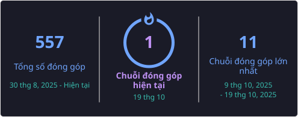

## 🌐Socials
      

## 💰 You can help me by Donating
   

  

  

# 💻Tech Stack

  
  
  
  
  
  
  
  
  
  
  
  
  
  
  
  
  
  
  

     

# 📊 GitHub Stats:

    
    
    
    

<picture>
  <source media="(prefers-color-scheme: dark)" srcset="https://raw.githubusercontent.com/tongsangtv/tongsangtv/output/pacman-contribution-graph-dark.svg">
  <source media="(prefers-color-scheme: light)" srcset="https://raw.githubusercontent.com/tongsangtv/tongsangtv/output/pacman-contribution-graph.svg">
  
</picture>

## 🏆GitHub Trophies

### ✍️ Random Dev Quote

### 🔝 Top Contributed Repo

---

